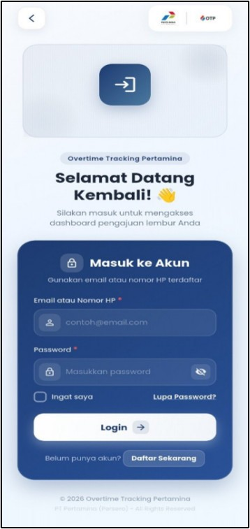
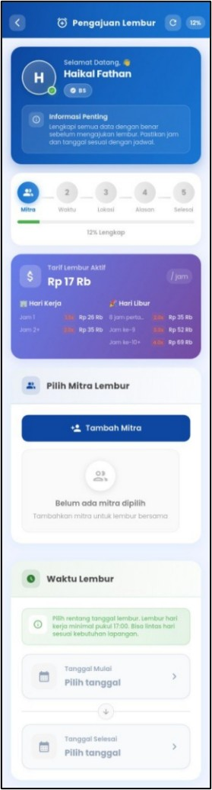
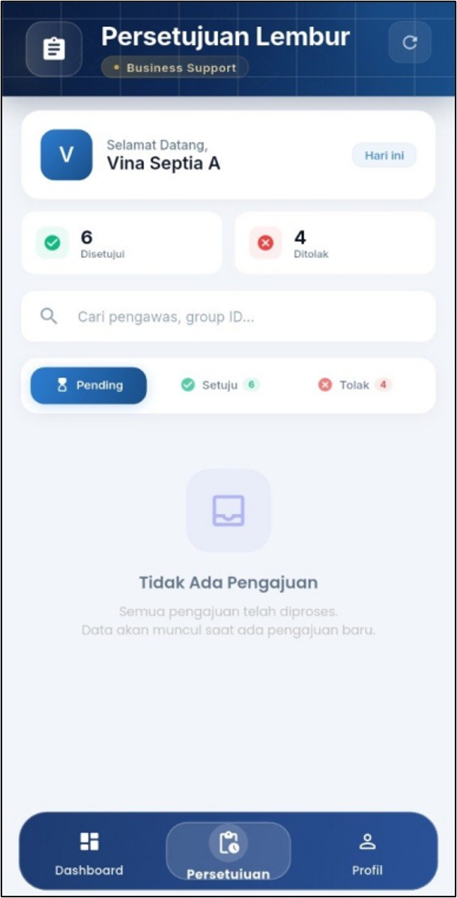

# Overtime Tracking Pertamina (OTP)

Aplikasi mobile berbasis Flutter untuk pengajuan, persetujuan, dan pemantauan lembur Tenaga Alih Daya (TAD), dikembangkan sebagai studi kasus di PT Pertamina Geothermal Energy (PGE) Area Kamojang.

> Proyek skripsi Sistem Informasi, IPI Garut (2026).
> Seluruh data pada repositori ini adalah data dummy.

## Tampilan Aplikasi

| Login | Pengajuan Lembur | Persetujuan | 
|-------|------------------|-------------|
|  |  |  |

## Latar Belakang Masalah

Pengelolaan lembur TAD di PGE Area Kamojang masih memiliki kelemahan pada prosedur, pengawasan, dan validasi:

- Pengajuan lembur masih bisa dilakukan secara informal (pesan instan, lisan, atau input mandiri) tanpa verifikasi yang kuat.
- Pengajuan sering dilakukan mendadak atau setelah pekerjaan selesai.
- Belum ada validasi lokasi, sehingga lembur yang diajukan berisiko tidak sesuai dengan kondisi sebenarnya di lapangan.

Akibatnya, akurasi pencatatan, pengawasan, transparansi, dan perhitungan upah lembur menjadi terganggu.

## Solusi

OTP mengintegrasikan seluruh proses lembur dalam satu aplikasi mobile, dengan pendekatan yang disesuaikan kebutuhan lapangan:

- **Pengajuan diinisiasi Pengawas**, karena Pengawas mengetahui langsung kebutuhan pekerjaan di lapangan dan menjadi kontrol awal.
- **Validasi lokasi berbasis GPS** saat pengajuan dan pelaksanaan lembur.
- **Alur persetujuan berdasarkan peran** (RBAC).
- **Pemantauan aktivitas dan perhitungan lembur** dalam satu platform.

## Fitur Utama

- **Absensi lembur berbasis foto** untuk memastikan lembur benar-benar dilaksanakan
- **Pengajuan lembur** oleh Pengawas
- **Alur persetujuan lembur** oleh pihak yang berwenang
- **Role-Based Access Control (RBAC)** dengan hak akses berbeda untuk setiap peran
- **Rekap pendapatan/upah lembur**
- **Pemantauan lokasi secara real-time**
- **Notifikasi push** untuk status pengajuan dan persetujuan
- **Ekspor laporan** ke PDF dan Excel/CSV

## Teknologi yang Digunakan

| Bidang | Teknologi |
|--------|-----------|
| Framework | Flutter (Dart) |
| Backend | Firebase (Auth, Cloud Firestore, Storage, Cloud Messaging, Analytics, Crashlytics) |
| State management & routing | Provider, go_router |
| Peta & lokasi | flutter_map, geolocator, geocoding |
| Grafik | fl_chart |
| Ekspor | pdf, printing, excel, csv |
| Media | camera, image_picker, Cloudinary |
| Keamanan | local_auth, crypto |

## Metode Pengembangan & Pengujian

- **Metode:** Rapid Application Development (RAD)
- **Black-box testing:** 60 test case pada 6 peran pengguna. 58 test case (96,7%) berstatus Pass, sedangkan 2 temuan lainnya dievaluasi sebagai keputusan desain yang disengaja (accepted). Sistem dinyatakan layak Go-Live.
- **Usability testing (Maze):** 5 partisipan dengan 84 observasi menghasilkan success rate 98,92% (weighted), di atas ambang kelayakan 85%.
- **User Acceptance Testing (UAT):** 20 responden memberikan rata-rata skor 90,5%, dengan seluruh aspek pengujian berada pada kategori "Sangat Layak" (81%-100%).

## Cara Menjalankan

**Prasyarat:** Flutter SDK 3.x dan sebuah proyek Firebase.

```bash
git clone https://github.com/vinaseptiaanggraeni91-ops/Overtime-Tracking-Pertamina-OTP-.git
cd Overtime-Tracking-Pertamina-OTP-
flutter pub get
```

1. Buat proyek Firebase, lalu letakkan `google-services.json` milikmu sendiri di `android/app/` (tidak disertakan di repositori ini).
2. Salin `.env.example` menjadi `.env`, lalu isi dengan nilai milikmu sendiri.
3. Jalankan aplikasi:
```bash
flutter run
```

## Pembuat

**Vina Septia Anggraeni**
Lulusan Sistem Informasi, IPI Garut
